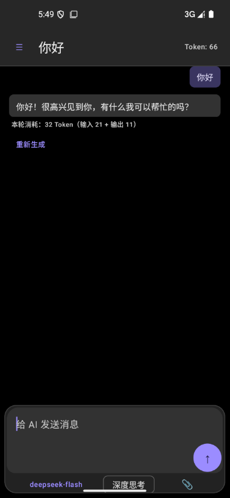

# LLMChatMobile

一个不一样的 Android 原生 LLM 聊天客户端——一般客户端没有的**双层系统提示词（对话模式）**与**环境上下文注入**，这里有。支持 OpenAI 兼容接口（DeepSeek / OpenAI / 智谱 GLM / 通义千问 / Ollama / 自定义）。

> 本应用仅为 API 调用客户端，**不提供 AI 生成服务**。使用时需要自行准备第三方大模型服务的 API Key。

当前处于 **beta 阶段**，功能可用，接口和数据结构仍可能调整。

## 使用教程（给第一次使用的朋友）

**第 1 步：安装应用**

1. 从本仓库的 Release 页面下载最新的 `LLMChat_beta0.4.0_android_release.apk`。
2. 把 APK 传到你的安卓手机（微信文件传输助手、数据线、网盘都行）。
3. 在手机文件管理器里点击这个 APK 安装。
4. 首次安装系统会提示「是否允许安装未知来源应用」，点允许即可。
5. 打开应用，跟随首次引导完成配置即可开始使用。

**第 2 步：配置你的 AI 服务（只需做一次）**

LLMChatMobile 本身不提供 AI 服务，你需要一个 API Key。下面以 DeepSeek 为例：

1. 打开 https://platform.deepseek.com 注册并登录。
2. 在「API Keys」页面创建一个 Key，复制下来（形如 `sk-xxxxxxxx`）。
3. 回到手机应用，点左上角 ☰ → 「设置」→「API 配置」。
4. 点「新增配置」，在「供应商」里选 **DeepSeek**（会自动填好地址和模型）。
5. 把复制的 Key 粘贴到「API Key」一栏，点「保存」。

> 其他服务（OpenAI、智谱 GLM、通义千问等）同理，只要在「供应商」里选对应项即可。如果你用的是中转服务，选「自定义」手动填地址。

**第 3 步：开始聊天**

1. 返回主界面，在底部输入框打字，点右侧的圆形 ↑ 按钮（或键盘上的发送键）发送。
2. 回复会像真人打字一样逐字出现。
3. 左下角显示当前模型，点它可以快速切换；旁边是「深度思考」开关。

**常见问题**

- **提示请求失败 / 无内容**：检查「API 配置」里的 Key 是否填对、是否还有余额、地址是否正确。
- **回复很慢或很久没反应**：可能网络问题，或模型在「深度思考」，可关掉开关试试。
- **想换模型**：聊天页左下角点模型名，或到「设置 → API 配置」新增/切换配置。

## 预览



## 功能

- **对话模式体系**：8 种内置模式（聊天 / 工作 / 代码开发 / 角色扮演 / 创意写作 / 自定义 / DS 网页版 / Legacy），双层系统提示词结构化拼接，模式绑定回复风格与采样参数；角色扮演支持角色卡快捷表单
- **流式对话**：手写 OkHttp SSE 解析，逐字输出，生成中可随时停止
- **多版本回复**：重新生成不覆盖旧回答，同一提问多版本保留，‹ 2/3 › 切换，每版本独立 Token 统计
- **消息操作**：长按任意消息复制全文；长按自己的消息编辑后重发（生成新一轮对话）
- **Markdown 渲染**：标题、列表、引用、表格网格线、代码块语法高亮（18 种语言，深浅主题双配色），代码块可一键复制；除表格外全局自动换行
- **深度思考**：推理模型的思考过程以小号半透明字体展示，可折叠
- **联网搜索**：DeepSeek 服务端搜索，实时显示搜索状态与网页数
- **多模态输入**：支持视觉模型的图片输入
- **环境上下文注入**：按模式在 system 末尾注入时间 / 星期 / 地区 / 客户端 / 语言（设置可开关，DS 网页版始终开启）
- **多会话管理**：新建对话即刻入列，长按可重命名 / 归档 / 导出 Markdown；启动自动恢复上次对话；归档会话可在设置中恢复
- **Token 统计**：每轮消耗、当前会话累计、全局累计三级展示，按日 / 按小时趋势图与模型分布，数据落 Room
- **多套 API 配置**：供应商预设自动填充，聊天页快速切换，每配置独立上下文 / 输出限制（高级选项），保存前可验证
- **上下文压缩**：纯本地滑动窗口裁剪，自动压缩开关
- **新对话默认模式**：可设置新建对话自动套用某模式，或禁用（新建时手动选择）
- **多语言**：简体中文 / 繁体中文 / English，切换即时生效
- **深浅主题**：深色 / 浅色 / 跟随系统，即时切换

## 技术栈

| 层 | 技术 |
|---|---|
| UI | Jetpack Compose + Material 3 |
| 架构 | 多模块 + MVVM + Hilt |
| 网络 | OkHttp + kotlinx.serialization（手写 SSE） |
| 存储 | Room（会话 / 消息 / token 用量）+ DataStore（配置） |
| 异步 | Kotlin Coroutines + Flow |

## 模块结构

```
:app              应用入口，唯一的实现组装处
:core:domain      领域模型与仓储接口（纯 Kotlin，无 Android 依赖）
:core:data        Room / DataStore 实现，Hilt 绑定
:core:network     OkHttp SSE 客户端
:feature:chat     聊天界面（只依赖 domain 接口）
```

依赖方向单向：`feature -> domain <- data <- network`，跨 feature 只走接口或路由。

## 构建

环境要求：JDK 17+、Android SDK Platform 35、Build Tools 35。

```bash
# 需要 local.properties 指向本机 SDK
echo "sdk.dir=/path/to/android-sdk" > local.properties

./gradlew :app:assembleDebug   # 编译 debug 包
./gradlew installDebug        # 安装到已连接设备
```

## 配置

应用内 **侧边栏 → 设置 → API 配置**：

1. 选择供应商（或选「自定义」）
2. 填写 Base URL 与 API Key
3. 选择 / 填写模型名

Base URL 需包含版本段（如 `https://api.deepseek.com/v1`），客户端会拼上 `/chat/completions`。

**API Key 只保存在本机 DataStore，不会上传或写进代码。**

## 已知限制

- 图片多模态仅支持 DeepSeek 视觉模型，其他供应商暂未扩展
- 上下文压缩使用字符数估算 token，非精确计数
- 尚未启用 R8 混淆（Hilt / Room / kotlinx-serialization 的 keep 规则待完善）

## 更新日志

### beta0.4.0

- 新对话立即保存到侧边栏（「新对话」），首条消息后自动更新标题
- 未指定模式的对话自动归入聊天模式；启动应用自动恢复上次对话
- 其余同 beta0.4.0prerelease（8 种对话模式/环境注入/多版本回复/渲染修复等）

### beta0.4.0prerelease

- 新增 8 种对话模式（双层系统提示词）：聊天/工作/代码开发/角色扮演（角色卡表单）/创意写作/自定义/DS 网页版/Legacy，模式绑定参数与回复风格，首条消息后锁定
- 环境上下文注入：DS 网页版自动注入时间/地区/客户端/语言；其他模式可在设置中开关
- 重新生成多版本保留（‹ 2/3 › 切换，每版本独立 Token 统计）；长按复制/编辑重发
- Markdown 渲染修复：代码块语法高亮折行、表格网格线、除表格外全局换行
- API 配置高级选项（独立上下文/输出限制）；设置页新对话默认模式
- 首次引导快速上手指南全面重写；关于页新增开发者名单；公告更新为 beta 阶段

### alpha0.3.1

- Markdown 渲染修复：代码块语法高亮（深浅主题双配色）、表格网格线、除表格外全局自动换行（含代码块折行）
- 长按消息可复制全文；长按自己的消息可编辑后重新发送
- 重新生成改为多版本保留，回复右上角可切换版本（‹ 2/3 ›），每版本独立 Token 统计
- 会话加载与导出只保留每组最新版本

### alpha0.3.0

- 新增 DeepSeek 联网搜索：服务端搜索 + 状态实时展示（正在搜索 → 已搜索 N 个网页 → 已联网搜索）
- 设置页 API 配置新增「验证配置」（与首次引导一致，成功自动保存）
- 输入栏重排：模型最左，联网搜索 / 深度思考 / 上传右对齐，开关字号缩小
- 模型选择菜单重构：纯文字 + 价格档位标签（便宜 / 中等 / 昂贵 / 非常昂贵）+ 底部配置自定义模型入口

### alpha0.2.1

- 开屏启动动画 + 5 步全屏首次引导（欢迎 / 测试声明 / API 配置验证 / 使用教程 / 完成）
- API 配置可先验证再进入应用，成功自动保存为默认配置
- 输入栏改版：功能栏更紧凑、发送按钮锚定右下角
- Token 统计改为二级页面，新增近 1 天（3 小时分段）/ 近 7 天柱状图
- 深色背景调整为近黑深灰，桌面应用名改为 LLMChat

### alpha0.2.0

- 图片多模态输入（DeepSeek 视觉模型）
- 流式中断、重新生成、会话导出、单会话独立提示词
- 主题跟随系统

### alpha0.1.0（初始版本）

- 流式对话 + Markdown 渲染 + 代码块复制
- 深度思考（可折叠思考内容）
- 多会话管理（重命名 / 归档 / 恢复 / 永久删除）
- 多套 API 配置 + 聊天页模型快速切换
- Token 三级统计、上下文压缩
- 深浅主题、三语切换
- 关于页、首次启动欢迎弹窗、自定义图标

## License

[MIT License](LICENSE) © BambooMosaic
