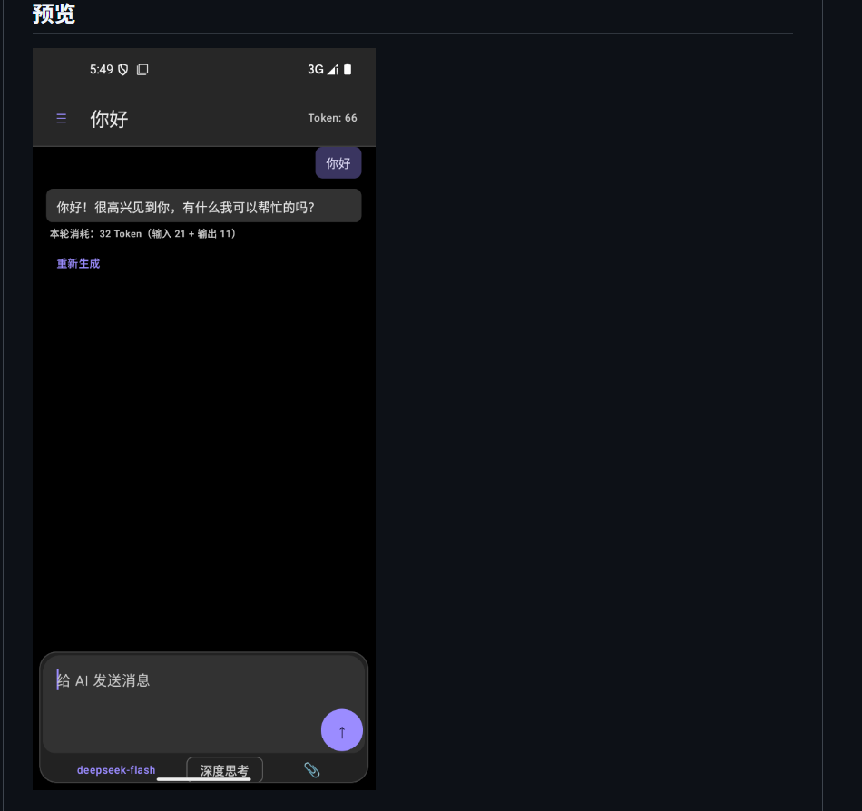

# LLMChatMobile

一个不一样的 Android 原生 LLM 聊天客户端——一般客户端没有的**双层系统提示词（对话模式）**与**环境上下文注入**，这里有。支持 OpenAI 兼容接口（DeepSeek / OpenAI / 智谱 GLM / 通义千问 / Ollama / 自定义）。

> 本应用仅为 API 调用客户端，**不提供 AI 生成服务**。使用时需要自行准备第三方大模型服务的 API Key。

当前处于 **beta 阶段**，功能可用，接口和数据结构仍可能调整。

## 使用教程（给第一次使用的朋友）

**第 1 步：安装应用**

1. [点击下载最新安装包](https://github.com/BambooMosaic/LLMChatMobile/releases/latest)——进入 Release 页下载 `LLMChat_betaX.X.X_android_release.apk`（文件名里的版本号会随更新变化，认准 Latest 标记即可）。
2. 把 APK 传到你的安卓手机（微信文件传输助手、数据线、网盘都行）。
3. 在手机文件管理器里点击这个 APK 安装。
4. 首次安装系统会提示「是否允许安装未知来源应用」，点允许即可。
5. 打开应用，跟随首次引导完成配置即可开始使用。

**第 2 步：配置你的 AI 服务（只需做一次）**

LLMChatMobile 本身不提供 AI 服务，你需要一个 API Key。下面以 DeepSeek 为例：

1. 打开 https://platform.deepseek.com 注册并登录。
2. 在「API Keys」页面创建一个 Key，复制下来（形如 `sk-xxxxxxxx`）。
3. 回到手机应用，点左上角 ☰ → 「设置」→「API 配置」。
4. 点「新增配置」，在「供应商」里选 **DeepSeek**（会自动填好地址和模型）。
5. 把复制的 Key 粘贴到「API Key」一栏，点「保存」。

> 其他服务（OpenAI、智谱 GLM、通义千问等）同理，只要在「供应商」里选对应项即可。如果你用的是中转服务，选「自定义」手动填地址。

**第 3 步：开始聊天**

1. 返回主界面，在底部输入框打字，点右侧的圆形 ↑ 按钮（或键盘上的发送键）发送。
2. 回复会像真人打字一样逐字出现。
3. 左下角显示当前模型，点它可以快速切换；旁边是「深度思考」开关。

**常见问题**

- **提示请求失败 / 无内容**：检查「API 配置」里的 Key 是否填对、是否还有余额、地址是否正确。
- **回复很慢或很久没反应**：可能网络问题，或模型在「深度思考」，可关掉开关试试。
- **想换模型**：聊天页左下角点模型名，或到「设置 → API 配置」新增/切换配置。

## 预览

| 聊天界面 | Markdown 渲染 |
|---|---|
|  |  |

## 开发记录

| 日期 | 内容 | Token 消耗 |
|---|---|---|
| 2026-11-18 | 搭建基础框架（多模块架构 / 流式对话 / 会话管理） | ~150M |
| 2026-11-19 | 扩展更多功能（Markdown 渲染 / 联网搜索 / 多模态 / Token 统计） | ~175M |
| 2026-11-20 | 加入重要功能（双层系统提示词模式体系 / 环境上下文注入） | ~175M |
| 2026-11-21 | 修复滚动抖动等 bug + 优化体验（代码块 UI / 省 Token 档位 / 多语言） | ~150M |
| 2026-11-22 | 发布 beta0.4.3 ~ beta0.6.0 共 6 个版本（搜索代理 / 用户称呼 / 模式导入导出 / 省 Token 档位 / 提问省钱模式 / 缓存与上下文统计 / 背景图与配色 / 浏览器直跳下载）；API Key 泄漏应急处理与仓库清理 | ~171M |
| **总计** | | **≥820M** |

## Roadmap（规划）

> 以下是正在酝酿的方向，发布顺序和内容可能调整，不构成承诺。

- **桌面端（1.0 之后的重头戏）**：基于 Kotlin Multiplatform + Compose Multiplatform，与 Android 端共享核心模块（双层提示词体系 / 省 Token 档位 / 手写 SSE 流式 / 模式导入导出全部复用），Windows / macOS / Linux 一套代码三端出包。分层架构当初就是为这一天准备的——领域层纯 Kotlin、网络层 OkHttp 本就跨平台，主要工作量在 Room/DataStore 的 KMP 化与依赖注入替换（Hilt → Koin）。已预留子项目目录 `LLMChatDesktop/`。
- **实验性毛玻璃 + 半透明磨砂材质**：输入栏、抽屉、各类弹窗与操作按钮的玻璃质感（Android 12+ 真模糊，旧系统降级为半透明），作为外观设置里的实验性开关提供。
- **钱包守护包（进行中）**：Token 折算金额（beta0.6.2 已上线）→ 容量预警变色 → 压缩前预览（已上线）。
- **会话管理增强**：置顶 / 分组 / 对话自动标题。
- **内置提示词模板库**：翻译官 / 周报生成 / 面试官 / 代码审查等一键存为模式，支持 JSON 分享。
- **消息分叉**：从任意消息另开分支，对话变树。
- **TTS 语音输出**：语音输入直接用输入法自带的即可。

## 功能

- **对话模式体系**：8 种内置模式（聊天 / 工作 / 代码开发 / 角色扮演 / 创意写作 / 自定义 / DS 网页版 / Legacy），双层系统提示词结构化拼接，模式绑定回复风格与采样参数；角色扮演支持角色卡快捷表单
- **流式对话**：手写 OkHttp SSE 解析，逐字输出，生成中可随时停止
- **多版本回复**：重新生成不覆盖旧回答，同一提问多版本保留，‹ 2/3 › 切换，每版本独立 Token 统计
- **消息操作**：长按任意消息复制全文；长按自己的消息编辑后重发（生成新一轮对话）
- **Markdown 渲染**：标题、列表、引用、表格网格线、代码块语法高亮（18 种语言，深浅主题双配色），代码块可一键复制；除表格外全局自动换行
- **深度思考**：推理模型的思考过程以小号半透明字体展示，可折叠
- **联网搜索**：DeepSeek 服务端搜索，实时显示搜索状态与网页数
- **多模态输入**：支持视觉模型的图片输入
- **环境上下文注入**：按模式在 system 末尾注入时间 / 星期 / 地区 / 客户端 / 语言（设置可开关，DS 网页版始终开启）
- **多会话管理**：新建对话即刻入列，长按可重命名 / 归档 / 导出 Markdown；启动自动恢复上次对话；归档会话可在设置中恢复
- **Token 统计**：每轮消耗、当前会话累计、全局累计三级展示，按日 / 按小时趋势图与模型分布，数据落 Room
- **多套 API 配置**：供应商预设自动填充，聊天页快速切换，每配置独立上下文 / 输出限制（高级选项），保存前可验证
- **上下文压缩**：纯本地滑动窗口裁剪，自动压缩开关
- **新对话默认模式**：可设置新建对话自动套用某模式，或禁用（新建时手动选择）
- **多语言**：简体中文 / 繁体中文 / English，切换即时生效
- **深浅主题**：深色 / 浅色 / 跟随系统，即时切换

## 技术栈

| 层 | 技术 |
|---|---|
| UI | Jetpack Compose + Material 3 |
| 架构 | 多模块 + MVVM + Hilt |
| 网络 | OkHttp + kotlinx.serialization（手写 SSE） |
| 存储 | Room（会话 / 消息 / token 用量）+ DataStore（配置） |
| 异步 | Kotlin Coroutines + Flow |

## 模块结构

```
:app              应用入口，唯一的实现组装处
:core:domain      领域模型与仓储接口（纯 Kotlin，无 Android 依赖）
:core:data        Room / DataStore 实现，Hilt 绑定
:core:network     OkHttp SSE 客户端
:feature:chat     聊天界面（只依赖 domain 接口）
```

依赖方向单向：`feature -> domain <- data <- network`，跨 feature 只走接口或路由。

## 构建

环境要求：JDK 17+、Android SDK Platform 35、Build Tools 35。

```bash
# 需要 local.properties 指向本机 SDK
echo "sdk.dir=/path/to/android-sdk" > local.properties

./gradlew :app:assembleDebug   # 编译 debug 包
./gradlew installDebug        # 安装到已连接设备
```

## 配置

应用内 **侧边栏 → 设置 → API 配置**：

1. 选择供应商（或选「自定义」）
2. 填写 Base URL 与 API Key
3. 选择 / 填写模型名

Base URL 需包含版本段（如 `https://api.deepseek.com/v1`），客户端会拼上 `/chat/completions`。

**API Key 只保存在本机 DataStore，不会上传或写进代码。**

## 已知限制

- 图片多模态仅支持 DeepSeek 视觉模型，其他供应商暂未扩展
- 上下文压缩使用字符数估算 token，非精确计数
- 尚未启用 R8 混淆（Hilt / Room / kotlinx-serialization 的 keep 规则待完善）

## 更新日志

### beta0.6.2（钱包守护轮）

- **Token 折算金额**：统计页新增金额行「本次 ¥x / 累计 ¥y」，按当前模型公开报价折算（缓存命中/未命中/输出分开计价）；无报价模型自动隐藏；价格表集中在独立模块，调价改一处即可
- **会话内搜索**：侧边栏长按会话 →「会话内搜索」——顶部搜索栏实时过滤当前会话消息，命中关键词高亮，关闭即恢复完整对话
- **手动压缩预览 + 摘要字数自定义**：压缩弹窗明确显示「保留最近 4 条，其余 N 条压缩为 ≤上限字摘要」，待压缩过少时禁用确认；其他设置新增「压缩摘要上限（字）」100~1024 可调（默认 400），预览与提示词同步生效
- **主题跟随系统回归（默认关）**：浅色/深色预设组按位置一一配对（默认↔默认、黄↔棕、浅灰↔纯黑、浅粉↔深红），系统切换明暗自动使用对应组颜色，两组色块同时高亮当前配对；关闭则固定手动选中
- **Roadmap 上线**：桌面端（Compose Multiplatform，1.0 后启动）、实验性毛玻璃材质、会话置顶分组与自动标题、提示词模板库、消息分叉、TTS 已列入规划

### beta0.6.1

- **会话导出 JSON**：侧边栏长按会话新增第三种导出格式，与模式导出同一 JSON 结构（含模式信息与对话记录），可通过「新建对话 → 模式菜单 → 导入」还原
- **配色预设重构**：移除浅色/深色模式开关，改为「浅色预设 ×6 / 深色预设 ×6」两组共 12 套（新增 浅灰 / 浅粉 / 纯黑 / 深红），选预设即定明暗；修复非默认配色下弹出菜单阴影/背景偏色（surfaceTint 染色问题）；旧配色设置自动迁移
- **省钱模式硬上限**：「最多输出 N 字符」从提示词软约束升级为硬性 max_tokens（此前模型经常超字；终极档锁定 64）；内置提示词措辞加严
- **设置页动画修复**：快速连点菜单不再出现页面卡没消失（切页动画加飞行锁 + 进出场时长对称）
- **统计 UI 主题化**：上下文面板容量分项、Token 统计柱状图与图例由硬编码紫色改为主题色透明度分层，任意配色下不再跳戏
- **上下文面板微调**：会话 token 行移除「联网搜索」项（DeepSeek 原生搜索消耗无法单独采集，该项恒为 0）
- 其他：棕色预设去红、浅粉预设加重、"默认"预设显示名修正

### beta0.6.0

- **修复升级清库隐患（重要）**：beta0.6.0prerelease 漏注册数据库 9→10 迁移，从 beta0.5.0 直接升级会触发破坏性迁移清空对话与 API 配置；本版补注册并新增 10→11 迁移，升级自动保留全部历史数据
- **表格单元格 Markdown 修复**：`**加粗**` 此前在表格里显示星号原文，现在正常渲染为粗体
- **「下载最新安装包」改为浏览器直跳**：获取最新正式版 APK 直链后直接用浏览器打开下载（系统下载器在部分机型/网络下连不上 GitHub，一直卡进度）；获取失败自动回退 Releases 页
- **上下文统计面板改版**：容量分项移除「联网搜索」（搜索内容不进上下文，分项剩 系统提示词/消息/深度思考 三项）；本对话 Token 行扩为五项——缓存命中 / 输入 Token / 输出 Token / 联网搜索 / 深度思考
- 联网搜索 Token 仅统计代理搜索轮次（其他模型经 DeepSeek-Flash 联网）；DeepSeek 原生搜索消耗计入输入/输出（API 不拆分）
- 深度思考 Token 取自 API 返回的 reasoning_tokens 明细（推理模型才有值，已含在输出内）

### beta0.6.0prerelease

- **省 Token 档位升级为 5 档**：关闭 / 质量（输出 4096，上下文 120k 压缩）/ 中等（1024，50k）/ 最大（256，30k，禁搜索禁思考）/ 终极（输出 64、输入 1024、10k 压缩、禁搜索禁思考、仅省钱模式对话可用）；档位控件改为可拖动滑块（带切换动画），终极档带警示特效；输出限制对创意写作 / 代码开发豁免；档位逻辑对 DS 网页版 / Legacy 豁免（终极档除外）
- **新增提问模式**：输入提问主题 + 理由详细程度滑块（禁用/简单/详细），AI 先给结论再说明理由；不支持自由改写用户层提示词
- **新增省钱模式**：单层提示词架构，自定义最多输出字符（16~1024，终极档锁定 16~64）与补充信息（≤256 字）
- **缓存命中统计**：统计页新增缓存命中卡片，柱状图改三色（缓存命中/输入/输出三种紫）；DeepSeek 系自动采集命中数据
- **上下文统计面板**：顶栏 Token 文本替换为环形进度按钮（上下文容量占比），点击打开面板——本对话命中/输入/输出、容量占用四色分项（消息/深度思考/联网搜索/系统提示词）；容量取 API 高级选项的最大上下文 Token，默认 1000k；含手动压缩入口（占位，自动压缩已按档位运行）
- **自定义背景图**：外观设置选择图片，缩放居中铺满聊天页并叠加可读性遮罩，可一键清除
- **UI 配色预设**：深色 / 浅色各 3 套新增配色（蓝调 / 绿调 / 暖调），避开主紫色系，不破坏系统主题切换

### beta0.5.0

- **平板/横屏适配**：宽屏下侧边栏常驻展开（300dp 固定宽），与聊天内容并排；设置页改为双栏（左侧一级菜单常驻高亮，右侧二级内容实时切换）；手机端单栏与抽屉交互保持不变
- **搜索代理**：其他模型开启联网搜索后，先由 DeepSeek-Flash 联网搜索（气泡实时显示状态与网页数），结果注入当前模型作答；DeepSeek 模型仍走原生搜索；失败自动降级为无搜索回答并提示；搜索轮次计入 Token 统计
- **Markdown 表格重做**：撑满消息宽度，列宽按内容自动加权分配，长文本与单元格 `<br>` 正常换行；宽表格自动横向滚动（列宽不被挤压）
- **设置页体验**：弹窗高度固定消除切换抖动；页面切换平移+淡入淡出动画；新增「偏好设置」页（环境注入 / 用户称呼 / 新对话默认模式），其他设置瘦身
- **用户称呼**：其他设置 → 偏好设置自定义称呼，随环境上下文注入；DS 网页版模式不注入
- **模式导出/导入**：对话锁定后点模式按钮进入模式详情，可导出当前配置（用户层提示词或角色卡 + 括号开关 + 对话记录）为 JSON；开启新对话的模式菜单可导入 JSON，还原为自定义模式（含对话记录）
- **关于页「下载最新安装包」**：自动获取最新正式版 APK 直链，系统下载器后台下载（通知栏可见进度）；获取失败回退浏览器打开 Releases 页
- **交互反馈**：流式回复平滑滚动跟随；发送按钮与设置菜单按压缩放
- **关于页测试声明**前增加「注意！」提示

### beta0.5.0prerelease

- **平板/横屏适配**：宽屏下侧边栏常驻展开（300dp 固定宽），与聊天内容并排；设置页改为双栏（左侧一级菜单常驻高亮，右侧二级内容）；手机端单栏与抽屉交互保持不变
- **设置页切换抖动修复**：弹窗高度固定为屏幕 75%，页面切换不再因内容高度变化产生位移闪烁
- **设置页切换动画**：进入二级页面从右滑入、返回向右滑出，叠加淡入淡出
- **新增「偏好设置」页**：环境注入 / 用户称呼 / 新对话默认模式独立成页（语言设置与其他设置之间），其他设置页瘦身
- **关于页新增「下载最新安装包」**：自动获取最新正式版 APK 直链，系统下载器后台下载（通知栏可见进度）；获取失败回退浏览器打开 Releases 页
- **交互反馈**：流式回复平滑滚动跟随；发送按钮与设置菜单按压缩放
- 合并 beta0.4.5 全部功能：搜索代理（其他模型经 DeepSeek-Flash 联网）、用户称呼、模式导出/导入（含对话记录）

### beta0.4.5

- **新增搜索代理**：其他模型开启联网搜索后，先由 DeepSeek-Flash 联网搜索（气泡实时显示搜索状态与网页数），搜索结果注入当前模型作答；DeepSeek 模型仍走原生搜索；搜索失败自动降级为无搜索回答并提示；搜索轮次计入 Token 统计
- **新增用户称呼**：其他设置页可自定义称呼，随环境上下文注入；DS 网页版模式不注入
- **新增模式导出/导入**：对话锁定后点模式按钮，模式详情弹窗可导出当前配置（用户层提示词或角色卡 + 括号开关 + 对话记录）为 JSON；开启新对话的模式菜单可导入 JSON，还原为自定义模式（含对话记录）

### beta0.4.4

- **角色卡回显修复**：角色扮演保存的角色卡，重新打开编辑弹窗正常回显角色名与角色设定
- **括号开关修复（重点）**：括号描写规则从模式层系统提示词完全移除、迁移至用户层，由开关控制追加；并修复开关状态未传入提示词拼装管道导致关闭不生效的问题
- **灰色模式持久化修复**：聊天模式未填用户层提示词的对话，重启后不再漂移成自定义模式
- **新增灰色模式只读预览**：对话锁定（模式按钮置灰）后点击模式按钮，弹窗只读展示用户层提示词与角色卡内容，支持复制全文，无编辑/保存入口

### beta0.4.3

- **API 错误提示与解决指引**：401（Key 无效）/ 402（余额不足）/ 429（请求过快）/ 超时 / 断网分别给出对应处理建议，同一气泡内换行追加；未知错误显示通用排查提示
- **角色扮演括号开关**：角色扮演模式专属（模式编辑弹窗内），控制提示词中的括号动作规则，默认开，持久化保存
- 错误指引与开关文案同步简中 / 繁中 / English

### beta0.4.2

- **修复长对话滚动抖动**：上滑翻看历史时页面被瞬间拉回底部（3 小时排查的深层 bug，见 Release 说明）
- **Markdown 渲染库固定 0.32.0**：0.33+ 默认异步解析导致 item 首次组合高度剧变（跳变根源之一）
- 消息列表补稳定 key、图片解码期间等尺寸占位（消除二次测量跳变）
- 其余同 beta0.4.1（对话模式/环境注入/省 Token 档位等）

### beta0.4.1

- 修复归档死循环：空白临时对话不再入库、不在侧边栏显示；填入用户层提示词（或发送消息）才转正保存
- 归档所有会话后侧边栏保持空白，不再自动生成新会话
- 首次引导「配置你的 AI 服务」正文改白色，修复深色主题下看不清

### beta0.4.0

- 新对话立即保存到侧边栏（「新对话」），首条消息后自动更新标题
- 未指定模式的对话自动归入聊天模式；启动应用自动恢复上次对话
- 其余同 beta0.4.0prerelease（8 种对话模式/环境注入/多版本回复/渲染修复等）

### beta0.4.0prerelease

- 新增 8 种对话模式（双层系统提示词）：聊天/工作/代码开发/角色扮演（角色卡表单）/创意写作/自定义/DS 网页版/Legacy，模式绑定参数与回复风格，首条消息后锁定
- 环境上下文注入：DS 网页版自动注入时间/地区/客户端/语言；其他模式可在设置中开关
- 重新生成多版本保留（‹ 2/3 › 切换，每版本独立 Token 统计）；长按复制/编辑重发
- Markdown 渲染修复：代码块语法高亮折行、表格网格线、除表格外全局换行
- API 配置高级选项（独立上下文/输出限制）；设置页新对话默认模式
- 首次引导快速上手指南全面重写；关于页新增开发者名单；公告更新为 beta 阶段

### alpha0.3.1

- Markdown 渲染修复：代码块语法高亮（深浅主题双配色）、表格网格线、除表格外全局自动换行（含代码块折行）
- 长按消息可复制全文；长按自己的消息可编辑后重新发送
- 重新生成改为多版本保留，回复右上角可切换版本（‹ 2/3 ›），每版本独立 Token 统计
- 会话加载与导出只保留每组最新版本

### alpha0.3.0

- 新增 DeepSeek 联网搜索：服务端搜索 + 状态实时展示（正在搜索 → 已搜索 N 个网页 → 已联网搜索）
- 设置页 API 配置新增「验证配置」（与首次引导一致，成功自动保存）
- 输入栏重排：模型最左，联网搜索 / 深度思考 / 上传右对齐，开关字号缩小
- 模型选择菜单重构：纯文字 + 价格档位标签（便宜 / 中等 / 昂贵 / 非常昂贵）+ 底部配置自定义模型入口

### alpha0.2.1

- 开屏启动动画 + 5 步全屏首次引导（欢迎 / 测试声明 / API 配置验证 / 使用教程 / 完成）
- API 配置可先验证再进入应用，成功自动保存为默认配置
- 输入栏改版：功能栏更紧凑、发送按钮锚定右下角
- Token 统计改为二级页面，新增近 1 天（3 小时分段）/ 近 7 天柱状图
- 深色背景调整为近黑深灰，桌面应用名改为 LLMChat

### alpha0.2.0

- 图片多模态输入（DeepSeek 视觉模型）
- 流式中断、重新生成、会话导出、单会话独立提示词
- 主题跟随系统

### alpha0.1.0（初始版本）

- 流式对话 + Markdown 渲染 + 代码块复制
- 深度思考（可折叠思考内容）
- 多会话管理（重命名 / 归档 / 恢复 / 永久删除）
- 多套 API 配置 + 聊天页模型快速切换
- Token 三级统计、上下文压缩
- 深浅主题、三语切换
- 关于页、首次启动欢迎弹窗、自定义图标

## License

[MIT License](LICENSE) © BambooMosaic
